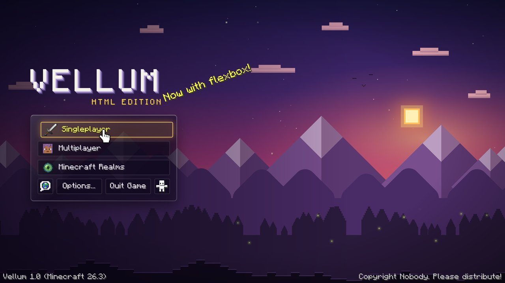
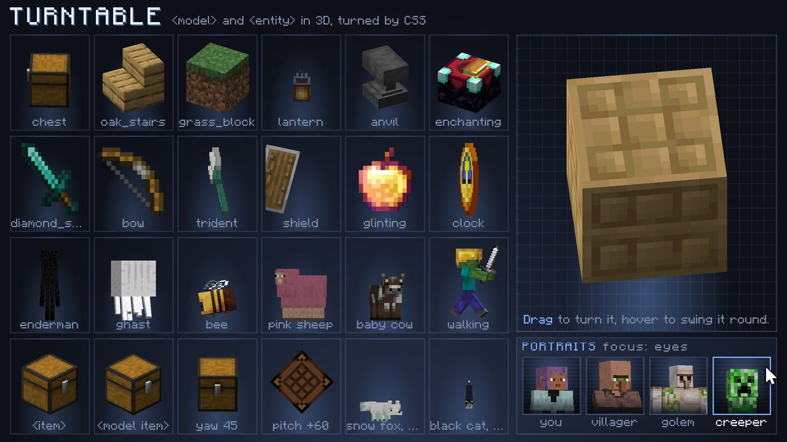
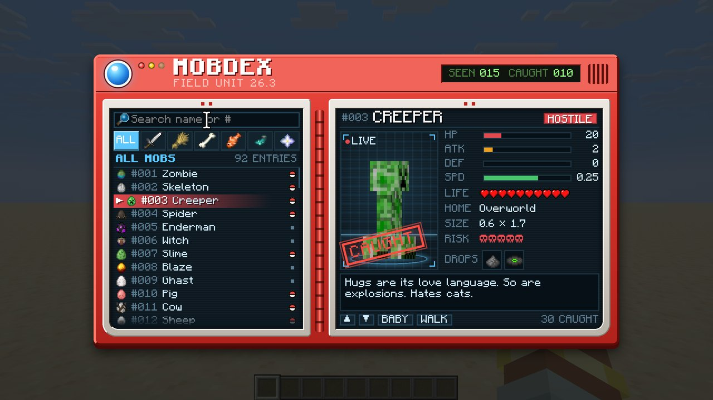
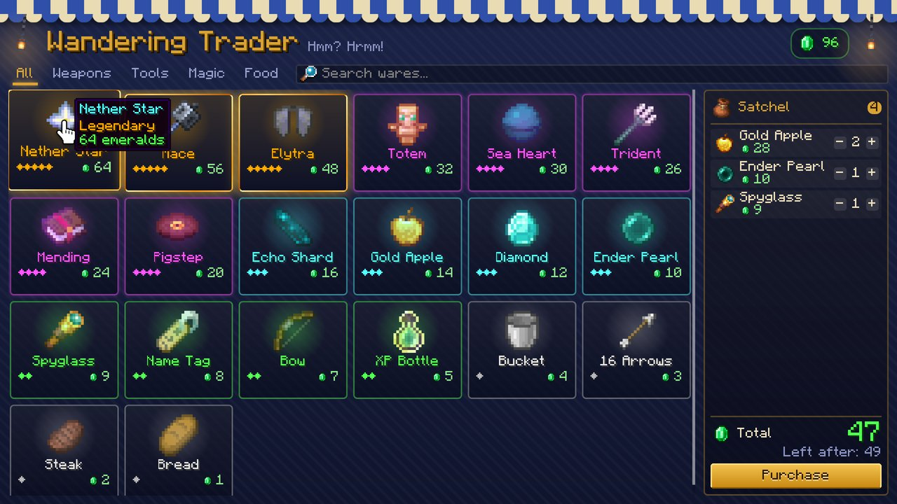

# Vellum

[CurseForge](https://www.curseforge.com/minecraft/mc-mods/vellum-gui) | [Modrinth](https://modrinth.com/mod/vellum-gui) | [Docs](docs/index.md)

Vellum is a small web engine inside Minecraft. Write your screens, inventories, HUDs, etc in HTML and Vellum handles the layout, scripting, and rendering with the normal GUI renderer. 

You probably don't need to install this on its own; Vellum is a library other mods depend on.

The inspiration for Vellum was three-fold:

- I'm a web developer and my Minecraft GUIs have always looked bad
- LLMs are better at web development than Minecraft GUI development
- Updating GUIs across Minecraft versions has always been a pain. With Vellum, your GUIs stay the same and just the library needs to be updated.

Vellum helps in all three cases. Opus 5.5 was used heavily in the development of Vellum.

<table>
  <tr>
    <td width="50%"></td>
    <td width="50%"></td>
  </tr>
  <tr>
    <td width="50%"></td>
    <td width="50%"></td>
  </tr>
</table>

### What you get

- Most of CSS: block, inline, flexbox, and grid support, transitions, selectors, and `@keyframes`. Its goal is to be a 90-10 solution compared to a complete browser.
- Elements use vanilla sprites by default. 
- Use `<slot index="0">` for inventory slots and vanilla mechanics will Just Work(tm): clicking, dragging, shift-clicking and tooltips.
- Minecraft-specific elements: `<item>`, `<slot>`, 3D `<entity>` and `<model>`, sprites, translations and player heads.
- JavaScript with Vue-style templates (`v-for`, `v-if`, `v-model`, `@click`).
- Narration/accessibility support and a standalone previewer with hot reload, so you (or your agent) can preview without launching the game.
- Speed. A few hundred elements restyle and relayout in well under a millisecond.

```html
<div class="mc-panel chest">
  <h2 class="mc-label">{{ title }}</h2>
  <div class="grid">
    <slot v-for="i in 27" :index="i - 1"></slot>
  </div>
  <button @click="vellum.send('sort')">Sort</button>
</div>
<style>
  .chest { width: 176px; margin: auto; }
  .grid { display: grid; grid-template-columns: repeat(9, 18px); }
  button { transition: transform .15s ease-out; }
  button:hover { transform: scale(1.05); }
</style>
```

### For mod developers

Vellum is in development. It's on [maven.maxleiter.com](https://maven.maxleiter.com):

```groovy
repositories { maven { url = "https://maven.maxleiter.com"; content { includeGroup("dev.vellum") } } }
dependencies { implementation("dev.vellum:vellum-neoforge-26.3:0.6.1") }   // or vellum-fabric-26.3, and the 1.21.1 ones
```

Feel free to bundle Vellum with your mod, or add it as a dependency. [`template/`](template/README.md) has small NeoForge and Fabric mods to start from. [The docs](docs/index.md) cover the Java side, [`docs/SCRIPTING.md`](docs/SCRIPTING.md) the JavaScript dialect and templates, and [`docs/MIGRATING.md`](docs/MIGRATING.md) porting an existing screen.

### Servers

A server mod can open a page on a player's client, push data to it and get messages back. Since a server might be hostile, scripts run in a Rhino sandbox with no Java access, no network access, no file access, and sensible caps. Players can always close a page with Shift+Esc, and `config/vellum.properties` lets them block server pages entirely.

## Examples

Full pages, opened in game with `/vellum showcase <name>`:

- [Title screen](common/src/main/resources/assets/vellum/vellum/showcase/title.html): the main menu with a parallax landscape
- [Turntable](common/src/main/resources/assets/vellum/vellum/showcase/models.html): blocks, items and mobs in 3D, turned by CSS
- [Mobdex](common/src/main/resources/assets/vellum/vellum/showcase/mobdex.html): a Pokédex for mobs, with live entities ([Java side](common/src/main/java/dev/vellum/mod/client/showcase/Mobdex.java))
- [Trader's market](common/src/main/resources/assets/vellum/vellum/showcase/shop.html): a shop with a satchel and checkout
- [Journal](common/src/main/resources/assets/vellum/vellum/showcase/journal.html): a quest book
- [HUD kit](common/src/main/resources/assets/vellum/vellum/showcase/hud.html): quest tracker, compass, boss bar and toasts
- [Console](common/src/main/resources/assets/vellum/vellum/showcase/console.html): a chat console for a robot

Smaller demos of one feature each, opened with `/vellum demo <name>`: [settings](common/src/main/resources/assets/vellum/vellum/demo/settings.html), [layout](common/src/main/resources/assets/vellum/vellum/demo/layout.html), [animation](common/src/main/resources/assets/vellum/vellum/demo/animation.html), [templates](common/src/main/resources/assets/vellum/vellum/demo/templates.html), [map](common/src/main/resources/assets/vellum/vellum/demo/map.html), [HUD overlay](common/src/main/resources/assets/vellum/vellum/demo/hud.html), [toast over chat](common/src/main/resources/assets/vellum/vellum/demo/toast.html) and a [vanilla chest](common/src/main/resources/assets/vellum/vellum/demo/chest.html) built from `<slot>`s ([server side](common/src/main/java/dev/vellum/mod/server/VellumDemos.java)).

`/vellum open <resource id>` opens any page and `/vellum reload` reloads them. In a dev client, saving a page under `src/main/resources` reloads it in the open screen.

## Previewer

You can also build pages without launching Minecraft. The previewer renders a page in a Swing window with the engine and the game's real font and sprites (read from your Minecraft jar), reloads when you save, and has an F12 inspector that outlines the hovered element's box model.

```bash
./gradlew :preview:run --args="path/to/page.html --scale 3 --size 427x240"
./gradlew :preview:run --args="page.html --snapshot out.png --frames 30"   # headless PNG
```

Flags, keys and how it finds the jar are in [`preview/README.md`](preview/README.md).

## Building

You need git and any JDK 17 or newer to start Gradle; Gradle downloads Java 25 to run itself (`gradle/gradle-daemon-jvm.properties`) and the toolchains it compiles with.

Vellum uses a patched [Rhino](https://github.com/mozilla/rhino). The build downloads the upstream source pinned in `gradle.properties` (once, checked
against its SHA-256), applies the patches in `rhino/patches` and compiles it, so there is nothing to install first.
[`rhino/README.md`](rhino/README.md) says what the patches do and how to change them.

```bash
./gradlew :engine:test                 # engine tests
./gradlew build                        # everything, every Minecraft version, including Fabric's headless GameTests
./gradlew :neoforge:26.3:runClient     # dev client (or :fabric:26.3, :neoforge:1.21.1, :fabric:1.21.1)
./gradlew :neoforge:26.3:runGameTestServer   # NeoForge's GameTests
./gradlew :preview:installDist         # previewer, at preview/build/install/preview/bin/preview
```

## Versions

Minecraft 26.3, 26.2 and 1.21.1, on NeoForge and Fabric (Fabric needs Fabric API). A few things differ on 26.2 and 1.21.1; [docs/versions.md](docs/versions.md) lists them and how the versions are built.

## Mods using Vellum

- [TileFinder](https://www.curseforge.com/minecraft/mc-mods/tilefinder)

## License

Vellum is MIT (`LICENSE`). The jars bundle Mozilla Rhino, which is MPL-2.0: it is built from the upstream commit
pinned in `gradle.properties` (Rhino 1.9.1) with the patches in [`rhino/patches`](rhino/patches), and its license,
notices and a note on where that source is ship in each jar under `META-INF/licenses/rhino/`.

LLMs were used heavily in the development of Vellum.
